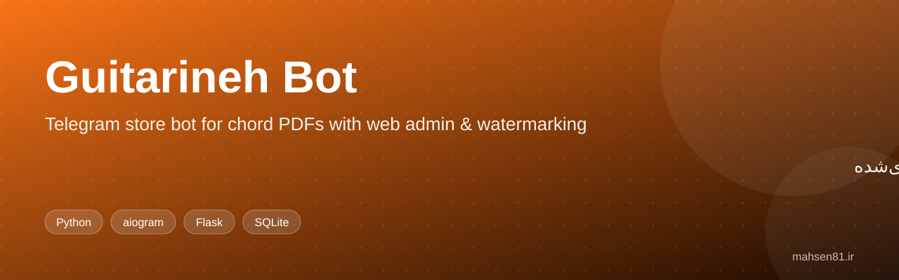

<!-- gen:header -->
<p align="center"></p>

<h1 align="center">Guitarineh Bot</h1>
<p align="center"><b>ربات فروش آکورد و پکیج PDF با پنل مدیریت و فایل رمزگذاری‌شده</b><br><i>Telegram store bot for chord PDFs with web admin & watermarking</i></p>
<p align="center">   </p>

<div dir="rtl">

## ✨ امکانات

- سفارش، سبد و پرداخت کارت‌به‌کارت
- پنل وب برای تأیید فیش و مدیریت محصول
- ارسال PDF رمزگذاری‌شده با واترمارک

</div>

## 🚀 Quick start

```bash
pip install -r requirements.txt
copy .env.example .env
python run.py
```

---

<!-- gen:docs -->
## 📚 مستندات کامل · Full documentation

# Guitarineh — ربات تلگرام گیتارینه (آفلاین + رمزگذاری)

**نام برند:** guitarineh  
**ربات:** [@guitarine_bot](https://t.me/guitarine_bot)

ربات فروش آکورد/پکیج PDF با پرداخت کارت‌به‌کارت، **پنل مدیریت تحت وب**، و ارسال فایل رمزگذاری‌شده با واترمارک.

## امکانات

1. **احراز هویت**: ارسال اجباری شماره موبایل با Share Contact
2. **سفارش**: انتخاب محصول، سبد، فیش (مبلغ + کارت + کد پیگیری)، آپلود عکس فیش
3. **پنل وب**: تأیید/رد فیش، مدیریت محصولات، تنظیمات ظاهر ربات
4. **PDF**: رمز = شماره موبایل، محدودیت کپی/ویرایش، واترمارک موبایل + آیدی تلگرام
5. **راهنما**: متن ثابت باز کردن فایل در Acrobat / Books

## پیش‌نیاز

- Python 3.11+
- توکن ربات از [@BotFather](https://t.me/BotFather)
- آیدی عددی تلگرام ادمین (مثلاً با `@userinfobot`)

## نصب

```bash
cd gbot
python -m venv .venv

# Windows
.venv\Scripts\activate

# Linux / macOS
source .venv/bin/activate

pip install -r requirements.txt
```

## پیکربندی

```bash
copy .env.example .env   # Windows
# یا: cp .env.example .env
```

مقادیر `.env` را پر کنید:

| متغیر | توضیح |
|--------|--------|
| `BOT_TOKEN` | توکن ربات |
| `ADMIN_IDS` | آیدی ادمین‌ها با ویرگول |
| `BANK_CARD` | شماره کارت برای کارت‌به‌کارت |
| `BANK_CARD_HOLDER` | نام صاحب حساب (اختیاری) |
| `OWNER_PDF_PASSWORD` | رمز مالک PDF (جدا از رمز کاربر) |
| `WEB_ADMIN_USER` | نام کاربری پنل وب |
| `WEB_ADMIN_PASSWORD` | رمز عبور پنل وب |
| `WEB_SECRET_KEY` | کلید امضای session (رشته تصادفی) |
| `WEB_HOST` | آدرس bind (پیش‌فرض `127.0.0.1`) |
| `WEB_PORT` | پورت پنل (پیش‌فرض `8080`) |
| `WEB_BASE_URL` | آدرس عمومی پنل برای لینک `/admin` در ربات |

## فایل‌های محصول

PDFهای خام را در `data/products/` بگذارید. در اولین اجرا سه محصول نمونه در دیتابیس seed می‌شود:

- `beginner-chords.pdf`
- `advanced-chords.pdf`
- `iranian-pop.pdf`

اگر این فایل‌ها نباشند، با اسکریپت زیر نمونه‌ها ساخته می‌شوند:

```bash
python scripts/make_sample_pdfs.py
```

برای محصول واقعی، PDF خودتان را با همان نام جایگزین کنید یا مسیر/`products` را در دیتابیس به‌روز کنید.

## اجرا

**ربات + پنل وب (پیشنهادی):**

```bash
python run.py
```

فقط ربات تلگرام (بدون پنل):

```bash
python -m bot.main
```

فقط پنل وب:

```bash
python run_web.py
```

**Deploy روی DirectAdmin:** راهنمای کامل → [`docs/DEPLOY_DIRECTADMIN.md`](docs/DEPLOY_DIRECTADMIN.md)

پنل: [http://127.0.0.1:8080](http://127.0.0.1:8080) — با `WEB_ADMIN_USER` / `WEB_ADMIN_PASSWORD` وارد شوید.

## جریان کاربر

1. `/start` → ارسال شماره موبایل
2. محصولات → افزودن به سبد → نهایی کردن سفارش
3. واریز به کارت و ارسال عکس فیش
4. پیام: «فیش شما دریافت شد… ظرف ۳۰ دقیقه…»

## جریان ادمین (پنل وب)

1. کاربر فیش را در ربات آپلود می‌کند
2. ادمین در پنل وب → **سفارش‌ها** فیش را می‌بیند
3. **تأیید و ارسال** → PDF رمزگذاری‌شده برای کاربر در تلگرام ارسال می‌شود
4. یا **رد** → کاربر در تلگرام مطلع می‌شود

دستور `/admin` در ربات فقط لینک پنل وب را نشان می‌دهد.

## ساختار

```
bot/            # ربات تلگرام (کاربران)
web/            # پنل مدیریت FastAPI
run.py          # اجرای همزمان ربات + پنل
```

---

<p align="center">ساخته‌شده توسط <a href="https://mahsen81.ir"><b>محسن جباره‌اصل</b></a> — برنامه‌نویسی، طراحی سایت، ربات و هوش مصنوعی<br>
Built by <a href="https://mahsen81.ir">Mohsen Jabbareh-Asl</a> · ⭐ اگر مفید بود، ستاره بدهید · Need a custom version? <a href="https://mahsen81.ir">Get in touch</a></p>
